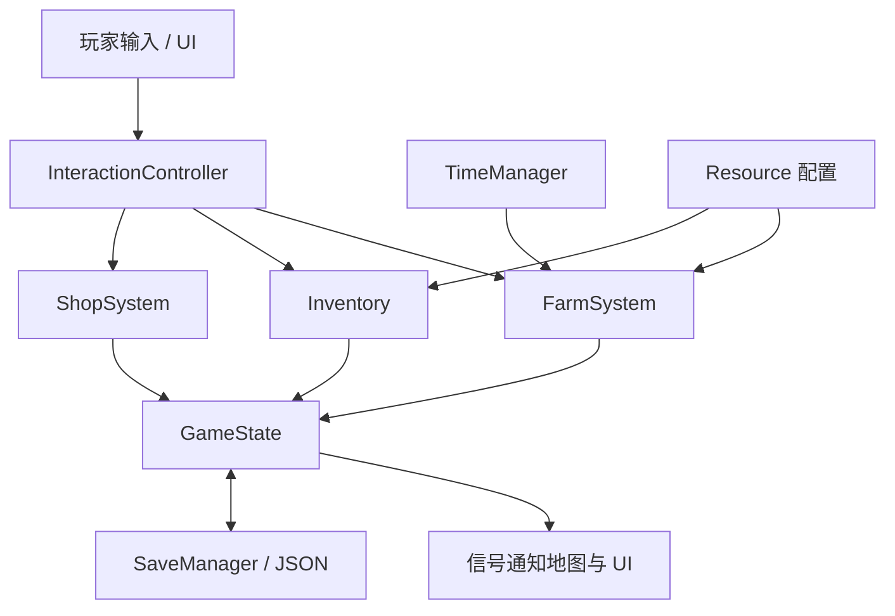

# Little Farm 游戏开发规划

版本：设计草案 v0.1，2026-11-19。以下参数是开发起点，尚未实测平衡；除仓库中的 CropTile 示例外，所述系统均为待实现。

## 1. 定位与范围

面向喜欢轻松经营的玩家，制作电脑端、单人、俯视角 2D 像素农场游戏。主要体验为每天照料土地、收获赚钱、逐步扩展农场，并与小镇居民交流。采用原创角色、故事和地图，不复制现有作品资产。

首个可玩版本只含一张农场、一间房屋、一个小型商店场景、一个 NPC、三种作物、背包快捷栏、日期体力、买卖和存读档。随后扩为五种作物、三名 NPC、简单任务和工具升级。联机、战斗、矿洞、婚恋、复杂天气、养殖及钓鱼不进入首版。

首版目标是让玩家完成连续七个游戏日的经营循环，体验种植选择和一次扩展奖励，而不是追求开放世界体量。

## 2. 核心循环与操作

购买种子 → 选择地块 → 翻地 → 播种 → 浇水 → 睡觉过夜 → 成熟 → 收获 → 出售 → 购买更多种子或升级。

- WASD/方向键移动；鼠标指向地块；左键使用当前工具或种子；E 交互/收获；数字 1—8 切换快捷栏；Tab 背包；Esc 暂停。
- 交互目标必须在允许距离内，地图边界与障碍需检查。UI 捕获鼠标时禁止穿透操作农田。
- 初始建议：200 金币、萝卜种子 5 个、锄头、水壶、100 体力。工具不消耗数量。
- 翻地/浇水成功各消耗 2 体力，播种/收获成功各消耗 1；无效动作不扣资源，体力不足不能执行。
- 每天 06:00 开始，现实约 10 分钟到 22:00；22:00 后可继续整理，02:00 强制结束当天。弹窗、商店、背包和暂停菜单冻结时钟。
- 睡觉或强制结束均走同一跨天入口，结算加锁，避免连点或多个触发源重复生长。首版过夜恢复全部体力，不加经济惩罚。

## 3. 五种作物与数值草案

生长单位为“浇过水并完成过夜的次数”。首版仅开放萝卜、土豆、胡萝卜；南瓜、玉米后续解锁。暂不做季节限制和重复收获。

| 作物 ID | 名称 | 种子价格 | 成熟天数 | 阶段阈值 | 单次产量 | 售价 |
|---|---|---:|---:|---|---:|---:|
| turnip | 萝卜 | 10 | 4 | 0 / 2 / 4 | 1 | 25 |
| potato | 土豆 | 20 | 5 | 0 / 2 / 5 | 1 | 45 |
| carrot | 胡萝卜 | 15 | 4 | 0 / 2 / 4 | 1 | 32 |
| pumpkin | 南瓜 | 50 | 8 | 0 / 4 / 8 | 1 | 130 |
| corn | 玉米 | 30 | 6 | 0 / 3 / 6 | 1 | 75 |

价格只是初值，后续按净收益/生长天数、体力成本、回本速度与新手破产风险调整。南瓜提供高投入长周期选择，萝卜提供快速回款。若金币与种子都为零，NPC 提供少量不可出售的救济种子，防止软锁。

## 4. 农田系统

### 数据与状态

地块键为地图 ID 加整数网格坐标。每块保存 tilled、watered、crop_id、growth_days；阶段从作物配置阈值推导。示例 CropTile 为便于理解显式保留 stage，正式存档不重复保存可推导阶段。

未翻地 → 空耕地 → 种子 → 生长期 → 成熟 → 空耕地。watered 独立于作物状态。

- 翻地只在合法可耕区域执行，已耕地不能重复翻地，不破坏现有作物。
- 播种要求耕地为空且背包有种子；允许先浇水后播种。
- 一天只需浇水一次，重复操作不扣体力。
- 过夜时，浇过水的未成熟作物 growth_days 加一；成熟后封顶；未浇水不长、不枯死。
- 生长结算后全部清除 watered，再进入新的一天。
- 收获检查成熟、背包容量、体力；全部成功才添加产物并清空作物，保留耕地与当日浇水状态。

### 数据所有权

CropTile 是单格教学原型。正式 FarmSystem 统一持有地块数据，视觉节点只展示，不再维护另一套可写农田状态。地块数量增加时用 Dictionary 和 TileMapLayer 批量展示，不为每格配置独立计时器或每帧更新。

### 事务边界

InteractionController 执行预检和同步提交：目标、距离、工具、体力、背包、地块状态都通过后一次提交。提交中不 await；异步动画在状态提交后播放。种子扣除后若播种意外失败立即回滚；收获满包则保持地块不变。changed 只通知显示，不能单靠信号异步发放奖励。

## 5. 背包与快捷栏

背包首版 24 格，快捷栏映射前 8 格，不复制物品数据。SlotData 保存 item_id 与 quantity，空格用空 ID 和 0；堆叠上限由物品配置决定，种子/产物建议 99，工具为 1。

Inventory 提供 can_add、add_item、remove_item、move_or_merge、use_selected。修改由数据层完成，UI 监听 slot_changed(index) 重绘；selected_slot_changed 通知玩家当前工具。

拖拽使用 Control 的 _get_drag_data、_can_drop_data、_drop_data：载荷只带源背包/格索引与版本，不带可独立增减的物品副本。预览不扣物品；落点合法后重新检查源数量与目标状态。空格移动、同物品合并至上限、不同物品交换；拒绝或拖到界面外保持原样。首版不支持丢弃与拆分，后续再加右键半组。

快捷栏切换只改变选择索引。使用种子消费一件，工具只扣体力；失败操作不扣物品。购买先验证金钱和完整容纳能力，出售先验证数量，同步修改金币和背包。首版不做部分成功的买卖，以减少理解成本。

## 6. 地图、NPC 与进度

农场提供约 20×12 可耕区域，房屋含睡床与存档交互，小镇商店包含种子交易。场景切换保留世界状态；通过稳定入口 ID 决定出生位置，避免重复生成玩家。

首版 NPC 提供问候、商店和引导。后续三名角色分别承担种植指导、交易、农场升级。对话配置包括 dialogue_id、节点、文本、选项、条件与效果；效果调用业务接口，不由 UI 直接改金币。

引导任务：翻一块地 → 播种 → 浇水 → 过夜 → 收获 → 出售。后续目标为累计出售、种植不同作物及扩展土地。奖励发放记录 completed/claimed，重复打开对话或读档不能重复领奖。

## 7. 技术栈与架构

| 层 | 技术/实现 | 职责 |
|---|---|---|
| 引擎 | Godot 4 稳定版本，开发启动时固定具体小版本 | 2D、输入、碰撞、音频、场景 |
| 脚本 | GDScript，重要字段与接口标注类型 | 游戏规则 |
| 地图 | TileMapLayer | 基础地面、障碍、耕地 |
| 动画 | AnimatedSprite2D / AnimationPlayer | 人物、工具及作物表现 |
| UI | Control、Container | 背包、快捷栏、对话、商店 |
| 静态配置 | 自定义 Resource（.tres） | 作物、物品、商店、任务 |
| 存档 | JSON + FileAccess，user:// | 游戏进度与设置 |
| 协作 | Git / GitHub | 版本、评审与问题记录 |

无需后端服务器或数据库。先开发桌面版本，浏览器/移动端留待输入与存档适配后另验。



GameState 作为持久状态根，模块对各自数据负责，UI 不直接改业务状态。模块采用明确信号，不建立任意字符串全局事件总线。跨场景持久节点仅保 GameState、TimeManager、SaveManager 等少量服务。

### 建议节点树

```text
Game
├── World
│   ├── Ground (TileMapLayer)
│   ├── Obstacles (TileMapLayer)
│   ├── Farm (Node2D / FarmSystem)
│   │   ├── SoilVisuals (TileMapLayer)
│   │   └── CropVisuals (Node2D)
│   ├── NPCs (Node2D)
│   └── Player (CharacterBody2D)
│       ├── AnimatedSprite2D
│       ├── CollisionShape2D
│       └── InteractionController
├── UI (CanvasLayer)
│   ├── HUD
│   ├── Hotbar
│   ├── InventoryPanel
│   ├── ShopPanel
│   └── DialoguePanel
└── Audio
```

跨天由唯一入口 end_day() 发出 day_ended，结算完成后 day_started。plot_changed(cell) 更新对应地块；slot_changed(index) 更新对应背包格。切换场景时解除旧订阅，避免同一个事件触发多次。

### 计划目录

```text
project.godot                 # 后续创建；当前尚不存在
scenes/{world,player,ui}/
scripts/{core,farming,inventory,player,shop,npc}/
data/{crops,items,dialogues,quests}/
assets/{sprites,tiles,audio,fonts}/
tests/
docs/GAME_PLAN.md
```

## 8. 存档设计

存档含 save_version、日期/时间、金币/体力、玩家地图和位置、背包格、地块、任务及奖励状态。静态配置只引用稳定 ID，不序列化节点、Resource 路径或对象实例。Vector2i 转成 x/y 整数，不直接作为 JSON 字典键。

```json
{
  "save_version": 1,
  "day": 3,
  "minutes": 360,
  "gold": 150,
  "energy": 100,
  "player": {"map_id": "farm", "x": 32, "y": 48},
  "inventory": [{"slot": 0, "item_id": "turnip_seed", "quantity": 3}],
  "plots": [{"map_id": "farm", "x": 2, "y": 3, "tilled": true, "watered": false, "crop_id": "turnip", "growth_days": 2}],
  "quests": []
}
```

过夜完整结算后自动保存，暂停菜单支持手动保存。先写临时文件并验证可解析，再替换主存档并保留上一份备份；写入失败时提示，不破坏旧存档。加载前验证版本、ID、范围及数量，异常存档可选择备份；不悄悄清空玩家进度。高于当前支持的版本拒绝加载，未来升级通过明确迁移函数处理。

## 9. 美术与声音

默认 16×16 地块、统一像素比例和最近邻采样；先用几何色块完成玩法，再换正式素材。人物四方向待机/行走/工具动作，作物每种至少三个阶段，土壤干湿两态。HUD 清楚展示金币、体力、时间和选中物品，不只用颜色表达成熟/缺水。

首版声音：轻量环境音乐、脚步、锄地、浇水、收获、交易与 UI 点击。音量分音乐/音效，提供静音。字体需覆盖中文。素材登记来源和许可证，未经允许的角色、音乐、地图不提交。

## 10. 分阶段开发与完成条件

工期仅作为一名熟悉 Godot 的开发者使用占位素材的估计，不是交付承诺；总计约 4—6 周，正式美术与额外内容另计。

| 阶段 | 预计 | 交付与通过条件 |
|---|---|---|
| M0 工程基础 | 2—3 天 | 固定引擎版本、输入映射、人物移动碰撞、地图和场景切换 |
| M1 种田闭环 | 4—5 天 | 萝卜从翻地到收获，过夜仅结算一次，画面同步 |
| M2 经济与背包 | 4—5 天 | 三种作物、24 格背包/8 格快捷栏、拖拽、买卖、体力 |
| M3 保存与引导 | 3—4 天 | 退出重进恢复完整状态、备份恢复、NPC 教程、七天循环 |
| M4 内容与体验 | 4—6 天 | 五种作物、三名 NPC、简单任务、一次升级、音画反馈 |
| M5 验收与导出 | 3—5 天 | 目标桌面平台试跑、缺陷修复、操作说明与版本包 |

每阶段先验证玩法再增加内容。优先处理存档损坏、物品复制/丢失、跨天重复结算及新手软锁，避免在闭环未稳定时扩地图。

## 11. 验收清单

- 未翻地不能播种；重复翻地/浇水/播种不扣资源；越界、距离不足、体力不足不改变状态。
- 浇水后过夜增长一次；未浇水不增长；成熟后封顶；跨天重入和强制睡觉不重复结算。
- 背包满时不能收获且作物保留；购买容量不足不扣钱；出售数量不足不发钱。
- 拖拽取消不丢物品；合并不超过上限；交换保持总数量；快捷栏和背包展示同一数据。
- 存读档往返后金币、物品、地块、时间与任务一致；坏档备份可恢复；任务奖励不重复。
- UI 点击不触发地面动作；场景切换后玩家不重复、事件不重复；暂停时钟确实停止。
- 用连续七天的真实游玩验证新手能完成循环；以目标设备实测帧率和过夜时间，不凭设计声称性能通过。

## 12. 后续扩展与当前状态

首版验收后再评估季节天气、钓鱼、养殖、装饰和更多任务，每次新增独立可验收的小版本。暂不设计联网服务、复杂 ECS 或插件化 Mod 框架。

当前仓库只有规划和单格示例。正式开发时需先生成 project.godot、场景与资源，将示例规则迁入统一数据层，并在固定 Godot 版本下做实际验证。发布可运行版本前必须更新 README 的运行步骤与已完成清单。
